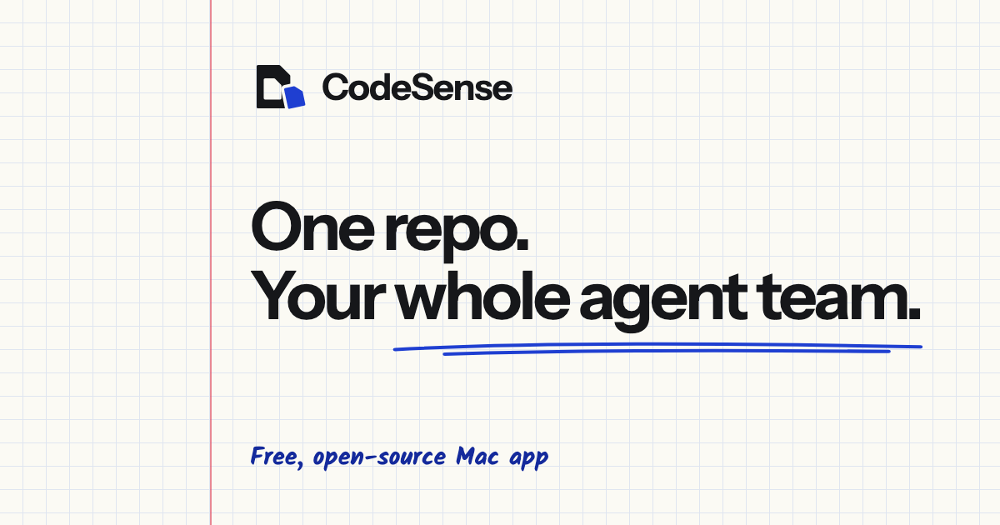

# CodeSense

<p align="center">
  
</p>

<p align="center">
  <a href="LICENSE"></a>
  <a href="https://github.com/codesensehq/codesense/releases"></a>
  
</p>

CodeSense is a Mac app that runs your team of Claude Code, Codex and OpenCode agents
across every repo, all in your own git. It gives each story its own worktree,
puts your team's context in each agent's worktree, and has an inbox where your
agents and you message each other.

> **Alpha, best effort.** CodeSense is early software maintained by one person.
> Expect rough edges and breaking changes between versions. Issues are triaged
> weekly, on a best-effort basis.

## Download

Download the DMG from [codesense.ai/download](https://codesense.ai/download),
open it and drag CodeSense to Applications.

The DMG is built, signed and notarized by the maintainer from the release's git
tag (`vX.Y.Z`). Builds are not yet reproducible.

The app checks for updates on its own and installs a newer, signed build when
you quit. See [PRIVACY.md](PRIVACY.md) for exactly what that check sends.

## Requirements

- A Mac with Apple Silicon. Tested on macOS 26 (Tahoe); older versions may work
  but aren't tested.
- An agent CLI to run, such as Claude Code, Codex or OpenCode, installed and signed in
  with your own account. CodeSense runs the CLIs; it makes no AI calls itself.
- git.

## Build from source

You need Node.js 24 (24.11 or a later 24.x), pnpm 10.16.1 (through `corepack enable`), the stable
Rust toolchain, `curl`, and the
[Tauri prerequisites](https://v2.tauri.app/start/prerequisites/) for macOS.

```bash
git clone https://github.com/codesensehq/codesense.git
cd codesense
corepack enable
pnpm install --frozen-lockfile
bash scripts/fetch-bundled.sh    # the pinned, checksummed binaries this OS bundles
pnpm build:emulator              # the terminal emulator worker
pnpm run tauri dev               # run it
pnpm tauri:build:unsigned        # or build a debug app, no signing or updater keys
```

On Linux, use the deb or rpm from a Tauri build, or build an AppImage with
`bash scripts/ci/unsigned-bundle.sh linux appimage`: the AppImage packer rewrites every
executable it bundles, which breaks the bundled starship and the terminal emulator, and that
script bundles it without the emulator and then repairs it with `scripts/ci/repair-appimage.sh`.
The repair needs `python3` and squashfs-tools (`unsquashfs` and `mksquashfs`) on top of the
Tauri prerequisites, and linuxdeploy, which packs the AppImage, needs `file`; on Debian or Ubuntu,
`sudo apt install python3 squashfs-tools file`. The script checks for all of these AppImage tools
before it starts the build.

A signed release build (`pnpm run tauri build`) needs your own Apple signing
identity and your own updater signing key; none are included here.

`scripts/fetch-bundled.sh` downloads the third-party binaries the app bundles on
this OS (git-ai on macOS and Linux; starship on Linux), each from its pin in
`src-tauri/pins/`, over HTTPS, with no GitHub login, and refuses each unless its
SHA-256 matches its pin. `bash scripts/fetch-bundled.sh --dry-run` prints the URLs
it would fetch. If a step
fails on a clean checkout, please open an issue.

A build from source uses the `internal` update channel by default and leaves out
dashboard publishing. The DMG from codesense.ai/download includes dashboard
publishing; see [PRIVACY.md](PRIVACY.md) for the calls it makes. If you redistribute a
build, see [Building your own release](#building-your-own-release).

## Test builds

A maintainer can build a test app from `main` without a local build: run the
**Test build** workflow from the Actions tab and pick a platform, or
`gh workflow run test-build.yml --repo codesensehq/codesense --ref main -f platform=macos`
(`platform=linux` for the Linux build; the default, `all`, builds every platform
the workflow has). A build takes about an hour. When it finishes, the run page
has its artifacts, kept for 7 days. There is no Windows build yet: `platform=windows`
runs nothing.

### macOS

The artifacts are `CodeSense.app.zip` (the app), the DMG and a manifest of the
bundle's files. The test build is not signed with an Apple Developer ID (it is
signed ad hoc) and not notarized, so macOS blocks it until you clear its
quarantine flag. Unzip `CodeSense.app.zip` (or open the DMG), move
`CodeSense.app` to Applications, then run:

```bash
xattr -dr com.apple.quarantine /Applications/CodeSense.app
```

### Linux

The artifacts are not signed, for two architectures. The x86_64 files (`..._amd64.deb`,
`...x86_64.rpm`, `...amd64.AppImage`) are built on Ubuntu 22.04 and run on Ubuntu 22.04 or
newer. The arm64 files (`..._arm64.deb`, `...aarch64.rpm`, `..._aarch64.AppImage`) are for
64-bit ARM machines, such as a Linux VM on an Apple silicon Mac; they are built on Ubuntu 24.04
and need Ubuntu 24.04 or newer. Install the one for your distribution and architecture:

```bash
sudo apt install ./CodeSense_*.deb        # Debian, Ubuntu
sudo dnf install ./CodeSense-*.rpm        # Fedora
chmod +x CodeSense_*.AppImage && ./CodeSense_*.AppImage
```

If the AppImage will not start for want of FUSE, install it (`sudo apt install libfuse2`,
or `libfuse2t64` on Ubuntu 24.04) or run it with `--appimage-extract-and-run`.

Remembering an SSH key passphrase is off on Linux for now (it needs a passphrase
prompt Linux doesn't have yet). Other saved secrets
are kept in Secret Service (GNOME Keyring or KWallet) when one is running, and
CodeSense says so when none is.

Every test build is a source build like the one above: the `internal` channel,
no update checks and no dashboard publishing.

## Regenerating exports

A few generated docs files are written only by Rust tests: the live-data
contract, the MCP registry export and the model schemas fixture. When
`pnpm gen:docs` says one is stale, a maintainer (running a workflow needs write
access) can regenerate it in CI instead of building Rust locally. Push your
branch first; it must be based on a `main` that has this workflow:

```bash
gh workflow run regenerate-exports.yml --repo codesensehq/codesense --ref <branch>
gh run list --repo codesensehq/codesense --workflow regenerate-exports.yml --branch <branch> --event workflow_dispatch --limit 1
gh run watch <run id> --repo codesensehq/codesense --exit-status
```

The second command prints the newest run's id. A new run takes a few seconds
to appear, so check that its start time is the one you just dispatched before
you use it; the third waits for it to finish. The default, `all`, runs every export,
then `pnpm gen:docs`. `-f exports=live-data-contract` (or `mcp-reference`,
`model-schemas`) runs one, but its `pnpm gen:docs` still fails if another export
is stale, so use `all` unless you know the others are fresh. The run's summary
lists the files it changed, and its `generated-exports` artifact holds them at
their repository paths, kept for 7 days. From the repository root, apply them
to your branch and commit them yourself:

```bash
tmp=$(mktemp -d)
gh run download <run id> --repo codesensehq/codesense -n generated-exports -D "$tmp"
cp -R "$tmp"/. .
(cd "$tmp" && find . -type f -print0) | xargs -0 git add --
git commit -s -m "Regenerate the generated exports"
```

When `live-data-contract.json` changed, add the `ci:macos` label to the pull
request: the test that pins the contract runs only on macOS. When nothing
changed, the summary says so and there is no artifact.

## Building your own release

If you give a build to other people, [TRADEMARKS.md](TRADEMARKS.md) asks you to
give it your own name, bundle identifier, update server and link scheme. These
are the settings to change. Line numbers are from the `main` branch at the time
of writing.

**Name and identity**

| Setting                                                                      | Where                                                 | Ours                                                                  |
| ---------------------------------------------------------------------------- | ----------------------------------------------------- | --------------------------------------------------------------------- |
| Product name (the app and `.app` bundle name)                                | `src-tauri/tauri.conf.json:3`                         | `CodeSense`                                                           |
| Window title                                                                 | `src-tauri/tauri.conf.json:15`                        | `CodeSense`                                                           |
| Bundle identifier (also names `~/Library/Application Support/ai.codesense/`) | `src-tauri/tauri.conf.json:5`                         | `ai.codesense`                                                        |
| App icons                                                                    | `src-tauri/tauri.conf.json:54-60`, `src-tauri/icons/` | see [TRADEMARKS.md](TRADEMARKS.md#files-the-mit-license-doesnt-cover) |
| Deep-link scheme (registered by the `beta` config only)                      | `src-tauri/tauri.beta.conf.json:5`                    | `codesense`                                                           |

**Updates and channel**

| Setting                                                                                     | Where                                                             | Ours                                           |
| ------------------------------------------------------------------------------------------- | ----------------------------------------------------------------- | ---------------------------------------------- |
| Build channel (`CODESENSE_CHANNEL`: `internal`, or `beta` with `CODESENSE_RELEASED_AT` set) | build environment, read at `src-tauri/build.rs:48`                | `internal` by default                          |
| Updater public key, built-in config                                                         | `src-tauri/tauri.conf.json:69`                                    | our minisign key                               |
| Updater endpoints                                                                           | `src-tauri/tauri.conf.json:70`                                    | `[]` (the app picks its update source itself)  |
| Updater public key, `beta` channel                                                          | `src-tauri/tauri.beta-prod.conf.json:7`                           | our production key                             |
| Download and update host, `beta` channel                                                    | `src-tauri/src/license/mod.rs:85`                                 | `dl.codesense.ai`                              |
| Update source for the `internal` channel (`CODESENSE_UPDATE_REPO`)                          | build environment, read at `src-tauri/src/commands/update.rs:113` | unset, so a source build makes no update check |
| Updater signing key (`TAURI_SIGNING_PRIVATE_KEY`, never in the repo)                        | build environment                                                 | use your own; it must match your public key    |

**Hosted services**

| Setting                                                                              | Where                                                                     | Ours           |
| ------------------------------------------------------------------------------------ | ------------------------------------------------------------------------- | -------------- |
| Public host, which the dashboard share host derives from (`share.<host>`)            | `src-tauri/build.rs:55`                                                   | `codesense.ai` |
| Dashboard sharing host (`CODESENSE_DASH_HOST`, with the `dashboard-publish` feature) | build environment, read at `src-tauri/src/dashboard_publish/client.rs:27` | unset          |

**Names stored on the user's Mac**

A build that keeps these shares data with an installed CodeSense on the same
Mac.

| Setting                                      | Where                                              | Ours                                             |
| -------------------------------------------- | -------------------------------------------------- | ------------------------------------------------ |
| App home folder                              | `src-tauri/src/commands/paths.rs:12`               | `~/.codesense`                                   |
| Keychain service, sign-in tokens             | `src-tauri/src/commands/credential_store.rs:21`    | `codesense-auth`                                 |
| Keychain service, SSH passphrases            | `src-tauri/src/commands/machines/passphrase.rs:15` | `codesense-ssh`                                  |
| Keychain service, dashboard publishing token | `src-tauri/src/dashboard_publish/client.rs:33`     | `ai.codesense.dashboards`                        |
| Keychain services, beta key                  | `src-tauri/src/license/static_channel.rs:33`       | `ai.codesense.beta`, `ai.codesense.beta-staging` |

**Signing.** Use your own Apple Developer ID and notarization credentials,
given to the Tauri build as its usual signing environment variables. Nothing in
the repository names ours.

## Project layout

- `src/`: the React frontend
- `src-tauri/`: the Rust backend and its workspace crates
- `src-emulator/`: the terminal emulator worker
- `codesense-docs/`: the product documentation shipped with the app
- `tests/`: end-to-end and conformance suites

## Questions and bugs

Report bugs in [GitHub issues](https://github.com/codesensehq/codesense/issues)
and ask questions in
[GitHub Discussions](https://github.com/codesensehq/codesense/discussions). See
[SUPPORT.md](SUPPORT.md) for where to ask what.

## Contributing

Pull requests, issues and discussions are welcome. See
[CONTRIBUTING.md](CONTRIBUTING.md) for how to contribute and
[MAINTAINERS.md](MAINTAINERS.md) for who maintains CodeSense. Everyone taking
part follows the [Code of Conduct](CODE_OF_CONDUCT.md).

## Security

Please report vulnerabilities privately, as described in
[SECURITY.md](SECURITY.md). Don't open a public issue.

## Privacy

The app has no analytics or telemetry. [PRIVACY.md](PRIVACY.md) lists every
network call the app makes, and what the website counts.

## Licence

The code is under the [MIT licence](LICENSE). The CodeSense name and logo are
not covered by it: see [TRADEMARKS.md](TRADEMARKS.md).
